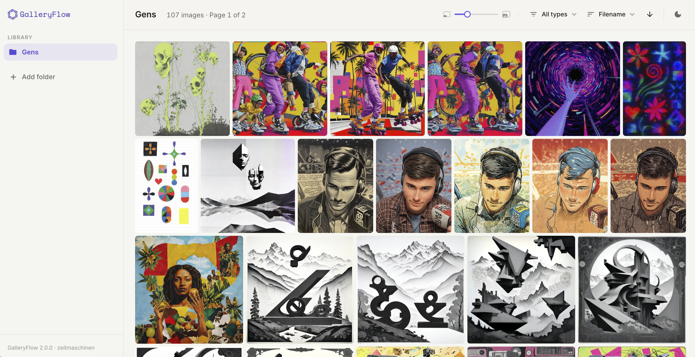
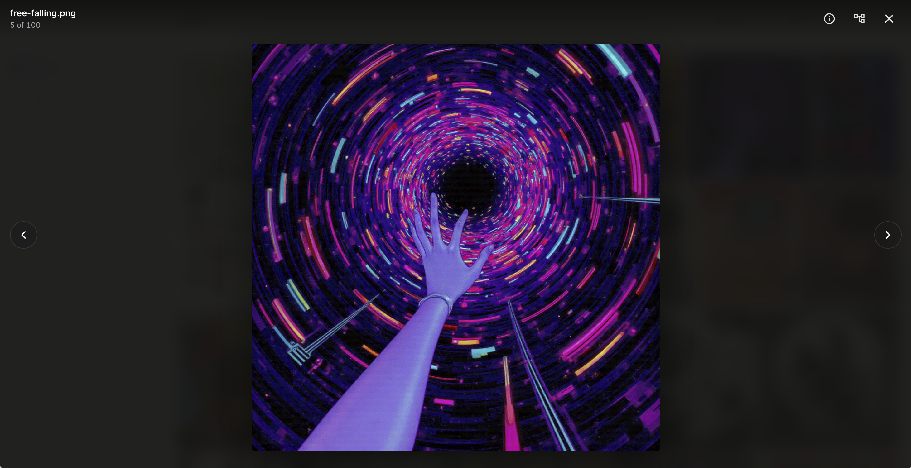
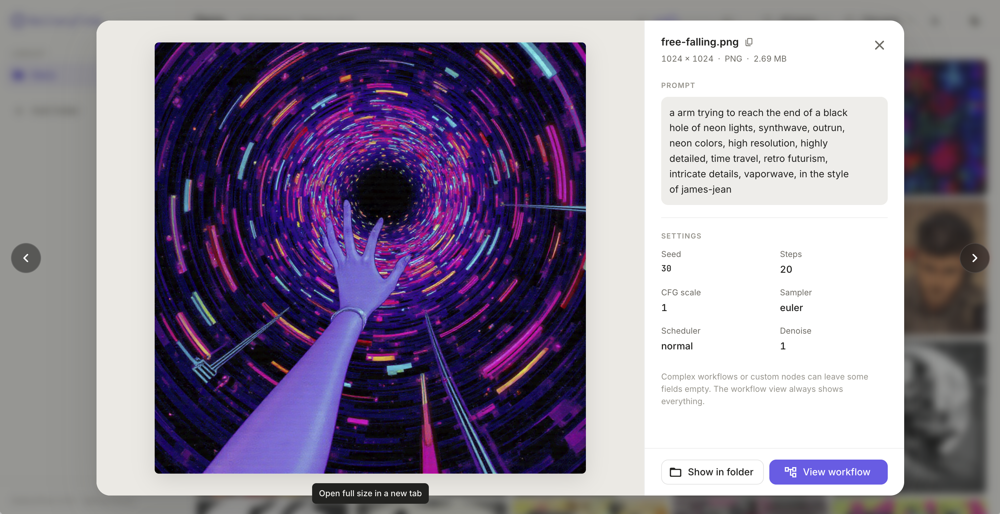
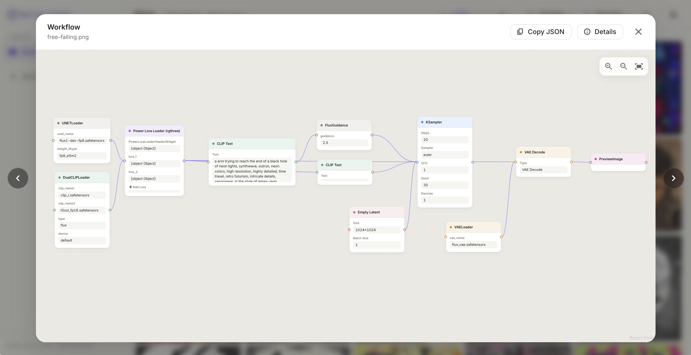

# GalleryFlow 2.0

A modern web application for browsing and managing <a href="https://github.com/Comfy-Org/ComfyUI" target="_blank" rel="noopener noreferrer">ComfyUI</a>-generated images with advanced metadata support.

Effortlessly connect to your ComfyUI output directory and instantly sort and filter your images, dive deep into advanced metadata extraction and visualize complete workflow nodes and their connections.

## What's new in 2.0

GalleryFlow 2.0 is a full redesign of the interface. Your images are now the focus:

- **A gallery that keeps every image's shape.** Portrait, square and landscape images sit together in neat rows, without cropping.
- **A calmer interface.** Warm neutral colours, a single slim toolbar, and a refined light and dark mode.
- **A new details panel.** A large image next to the prompt, model, settings and LoRAs, with one-click copy for prompts.
- **A distraction-free full-screen viewer**, with arrow-key navigation.
- **A cleaner workflow view**, with soft, colour-coded nodes.
- **Instant results when you add a folder.** The folder opens right away and images appear while it's being scanned.
- **Reads more images.** Prompts and workflows are now found in PNGs that earlier versions skipped, such as images saved from websites or the ComfyUI docs. Click **Rescan** on a folder once to pick them up.
- **Better on phones and tablets.**

## Features

- 📁 Browse your ComfyUI-generated images, including every subfolder
- 🖼️ Justified gallery that keeps each image's real shape, with adjustable size
- 🎨 Full-screen image viewer with keyboard navigation
- 📋 Generation details for each image: prompt, negative prompt, model, seed, steps, CFG, sampler, scheduler, LoRAs
- 🧩 Workflow visualization for each image, and copy the workflow JSON to the clipboard
- 🔄 Sort by subfolder, filename or date, and filter by file type
- 🌓 Light and dark mode

<br>



<br>



<br>



<br>



<br>

## Tech Stack
- **Frontend:** React 18, TypeScript, Material UI, Vite
- **Backend:** FastAPI, SQLAlchemy, Python 3.10+
- **Other:** React Flow, light/dark mode, responsive design

---

## Quick Start

### Prerequisites
- **Git**
- **Python 3.10+** (3.13 recommended)
- **Node.js** and **npm**

---

### 1. Clone the Repository

```bash
git clone git@github.com:zeitmaschinen/galleryflow.git
cd galleryflow
```

---

### 2. Install Backend Dependencies

```bash
cd backend
python3 -m venv venv         # or python -m venv venv on Windows
source venv/bin/activate     # or venv\Scripts\activate on Windows
pip install -r requirements.txt
cd ..  # Return to project root for next steps
```

---

### 3. Install Frontend (Node.js)

```bash
cd frontend
npm install
cd ..  # Return to project root
```

---

### 4. Start the Application (Every time you want to run the app)

On a terminal/command window **in the project root**, run:

```bash
source backend/venv/bin/activate     # or backend\venv\Scripts\activate on Windows
python3 run_galleryflow.py
```

- This will launch both the backend and frontend. 
- The backend will be available at [http://localhost:8000](http://localhost:8000).
- The frontend will be available at [http://localhost:5173](http://localhost:5173).

---

### Troubleshooting
If you're getting an error when installing npm, you likely need to install nodejs first.
Close your current terminal/command window, download and install Node.js from [nodejs.org](https://nodejs.org/), then open a new terminal and run `npm install` again.

---

### 5. To Open GalleryFlow

- Visit [http://localhost:5173](http://localhost:5173) in your browser.
- Add folder path from your ComfyUI images output.
- Enjoy! 🎉

---

### 6. Additional Notes

- Both the backend and frontend are started automatically by a python script for full functionality.
- To stop GalleryFlow, press **Ctrl + C** in the terminal window where it's running.

---

### Updating from an earlier version

From the project root, get the latest code and reinstall the frontend packages (2.0 changes them):

```bash
git pull
cd frontend
npm install
cd ..
```

Your library (the folders you've added) is kept. If you're coming from 1.2 or older, also run `python3 migrate_db.py` from the project root once.

## Configuration
- See `.env.example` for available configuration options.

## Contributing
- For advanced usage, troubleshooting, SSH setup, and contributing, see [CONTRIBUTING.md](CONTRIBUTING.md).

If this project is useful to you, please don't forget to give it a star! 🌟 🤗

## License
GalleryFlow is licensed under [Creative Commons Attribution-NonCommercial 4.0 International (CC BY-NC 4.0)](https://creativecommons.org/licenses/by-nc/4.0/). You're free to use, share and adapt it for non-commercial purposes, as long as you give credit. See the [LICENSE](LICENSE) file for the full text.

Before 2.0, GalleryFlow was released under the MIT License. Copies obtained under those earlier versions keep the MIT terms.
